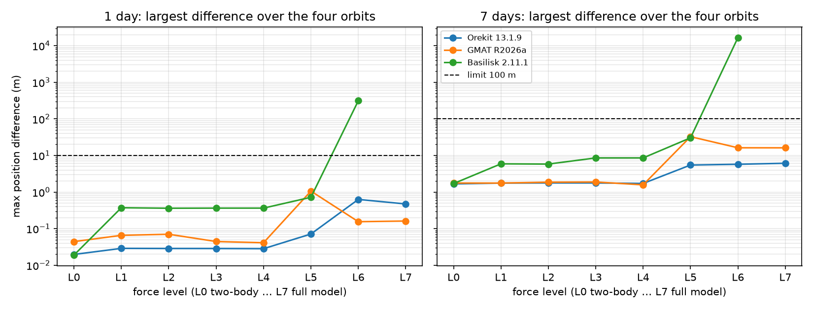
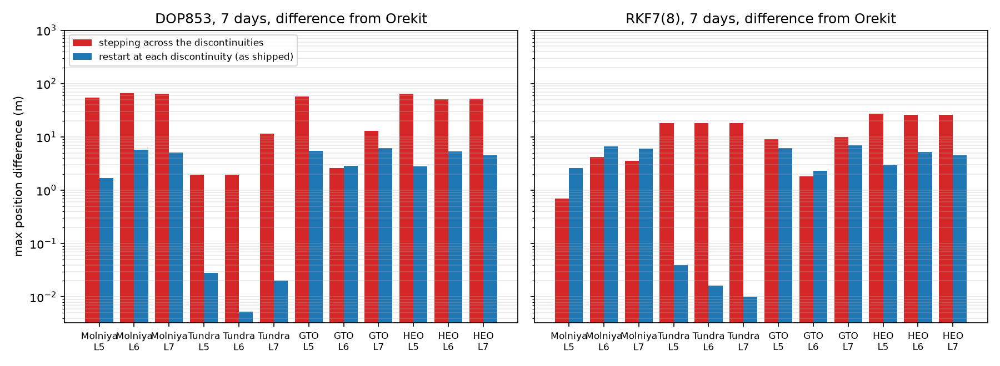
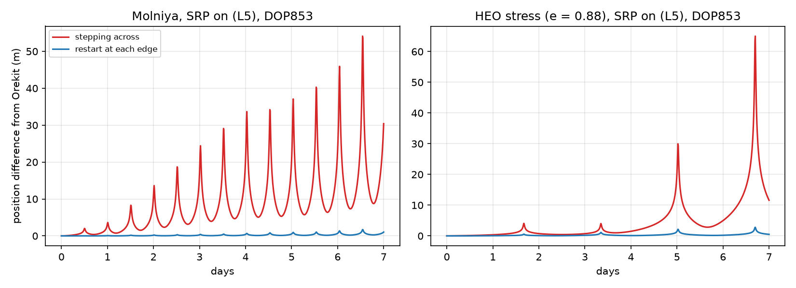
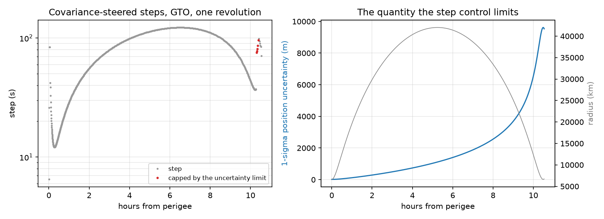
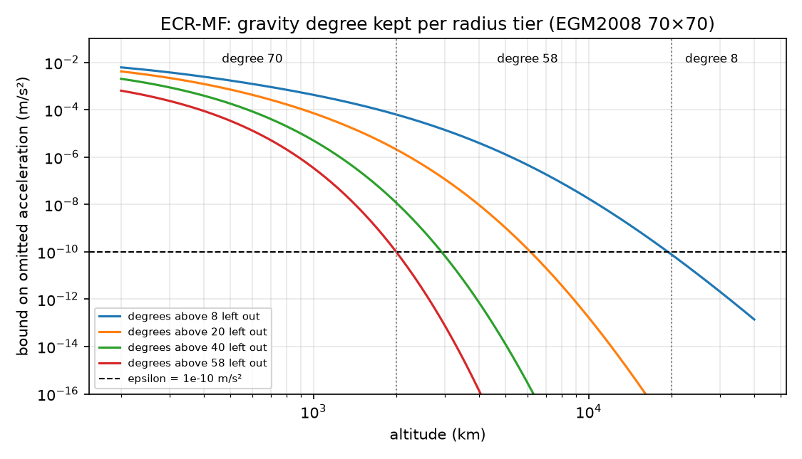

# AstroFlyer HEO — Technical Report

**Precise Trajectory Propagation and Events Prediction for Highly Eccentric Orbits (HEOs)**

Department of Aerospace Engineering, ACS College of Engineering (affiliated to VTU, Belagavi)

Candidates: Girish Gowda S (1AH23AS019), Gowtham N (1AH23AS020), Harshith S Purohith (1AH23AS021).
Guides: Mr. Vijay M (Assistant Professor), Dr. Suresh C (Professor & Head of Department).

Status as of October 2026 (branch `main`). Every number below was produced by the code in this
repository and can be regenerated with the commands given; the only figure quoted from elsewhere is
Woodburn's (2000), given for comparison in §4.

---

## 1. Summary

AstroFlyer HEO is an offline Windows desktop application for propagating spacecraft in highly eccentric
orbits (Molniya, Tundra, GTO, high-apogee science orbits, lunar transfers) and predicting their events
(apsides, nodes, eclipses, ground-station contacts).

* **Engine:** Python, NumPy and SciPy (Numba optional, for gravity), Cowell formulation in GCRF.
* **Force model:** EGM2008 gravity to 70×70, JPL DE440 Sun and Moon, solar radiation pressure with a
  WGS-84 conical shadow, NRLMSISE-00 drag (double-precision port) driven by the bundled CelesTrak
  daily F10.7/Ap history, and post-Newtonian relativity.
* **Default integrator:** SciPy DOP853, restarted exactly at shadow edges and drag-model jumps.
* **Validation:** the same 64 cases (four orbits, eight force levels, 1 and 7 days) cross-checked
  against three independent propagators (§4). All pass against Orekit and NASA GMAT. Against Basilisk,
  which has no relativity (56 cases), 52 pass; the four that fail are drag cases, from a documented
  difference in how Basilisk's atmosphere computes altitude.
* **Application:** a local Python server (127.0.0.1) and a browser console (Three.js 3D view, ground
  track, uPlot plots) in a native window through pywebview / Edge WebView2. All data ships with the
  installer; nothing is downloaded at runtime.

---

## 2. Architecture

| Layer | What it is | Main files |
| --- | --- | --- |
| Engine | Force model, trajectory integration, propagation, events | `backend/forces.py`, `trajectory.py`, `astro_engine.py`, `integrators.py`, `event_predictor.py`, `eclipse.py`, `access.py` |
| Time and frames | UTC/TAI/TT/TDB/UT1/GPS; IAU 2006/2000A GCRF↔ITRF with IERS EOP | `backend/epoch.py`, `frames.py`, `eop.py` |
| Server | Local HTTP adapters (`/api/propagate`, access, targeting, mission script) | `backend/app_server.py`, `propagation_run.py` |
| Console | Mission / Analysis / Data workspaces; 3D view, ground track, plots, watch panel | `frontend/` |
| Packaging | PyInstaller app + Inno Setup installer with bundled data and the WebView2 offline installer | `AstroFlyer.spec`, `build_release.py`, `installer/AstroFlyer_Installer.iss` |

There is no C++ kernel and no PyQt or OpenGL desktop code; earlier review documents that describe them
were wrong (see §7).

---

## 3. Methods

**Propagators.** DOP853 (default) and Radau from SciPy; in-house RKF7(8), Bulirsch–Stoer and fixed-step
RK4; analytic Kepler, J2 mean-element and SGP4. Every integrator runs through one trajectory
integration module (`backend/trajectory.py`), used by the propagate endpoint and by mission scripts,
targeting and finite burns alike. It stops and restarts at every umbra/penumbra edge and at the
altitudes and times where NRLMSISE-00 itself is discontinuous, so step control never straddles a kink;
RKF7(8) and DOP853 then agree to 1 cm over 7 days on Tundra with SRP (24.8 m apart before RKF7(8) got
the restarts). DOP853 is 5–6× faster than Radau on the validation cases and agrees with
it to 0.85 m over 32 days.

**Output sampling.** For display the API samples the integrated trajectory evenly in eccentric anomaly,
so perigee passes are drawn with as many points as apogee dwells. Validation uses uniform time.

**Events.** Apsides and nodes are located by root-finding on the dense output during integration;
eclipses from the conical umbra/penumbra model; ground-station AOS/LOS with elevation masks. Station
contacts, in a run's Events and timeline as in Analysis › Access, turn the trajectory into ITRF with the
IAU 2006/2000A chain at the run's real epoch, place the stations on the WGS-84 ellipsoid and refine AOS
and LOS between output samples with Brent's method. The radiation-belt dipole is fixed in ITRF in the
same way.

**Two propagation experiments**, measured against Orekit
([validation/results/innovations](validation/results/innovations/README.md)):

* *Covariance-steered stepping* (`steering="covariance"`): the state transition matrix is integrated
  with the orbit and each step is capped so the 1-σ position uncertainty grows by at most η. Against
  plain RKF7(8) (both restarting at shadow and drag boundaries) it improves a few 7-day cases
  (gravity-only GTO: 0.52 m → 0.17 m, and 0.16 m after the gravity-gradient fix of §7) at about 3× the run time; it makes some worse (GTO, full model:
  7.04 m → 7.78 m) and does not beat DOP853 overall.
* *ECR-MF fidelity tiers* (`fidelity="ecr_mf"`): above 2,000 km and 20,000 km altitude, gravity is cut
  to the lowest degree whose omitted acceleration is below 10⁻¹⁰ m/s². At 70×70 it stays within
  0.0032 m of the full model over a day, but gives no speed-up: gravity is not the costly force.

---

## 4. Validation

Four orbits (Molniya, Tundra, GTO, and an e = 0.88 stress orbit), epoch 2026-01-01 00:00 TT, the
same Cartesian start state, the force model built up one level at a time: L0 two-body, L1 J2,
L2 J2–J4, L3 8×8, L4 + Sun/Moon, L5 + SRP, L6 + drag, L7 + relativity. Every tool is given AstroFlyer's
own EGM2008 coefficients, spacecraft (Cr·A/m 0.02, Cd·A/m 0.01 m²/kg) and constant space weather
(F10.7 150, Ap 15). Limits: 10 m after 1 day, 100 m after 7 days.

Run 2026-10-28 (Python 3.14.6; [validation/results/rerun_2026-10-28](validation/results/rerun_2026-10-28)):

| Reference | Run | Largest position difference | Result |
| --- | --- | --- | --- |
| Orekit 13.1.9 | 1 day, L0–L7 | 0.63 m (GTO, drag on) | 32/32 pass |
| Orekit 13.1.9 | 7 days, L0–L7 | 6.12 m (GTO, full model) | 32/32 pass |
| NASA GMAT R2026a | 1 day, L0–L7 | 1.06 m (Molniya, SRP on) | 32/32 pass |
| NASA GMAT R2026a | 7 days, L0–L7 | 32.6 m (Molniya, SRP on) | 32/32 pass |
| Basilisk 2.11.1 | 1 day, L0–L6 | 0.72 m through L5; drag 313 m (GTO) | 26/28 pass |
| Basilisk 2.11.1 | 7 days, L0–L6 | 30.3 m through L5; drag 16.6 km (GTO) | 26/28 pass |

Through L4 (gravity, Sun and Moon) AstroFlyer agrees with all three to centimetres over a day. Each
larger difference was traced by an experiment that changed one side to match the other and watched the
difference vanish:

* **Shadow shape.** GMAT and Basilisk cast the Earth's shadow from a sphere; AstroFlyer and Orekit use
  the WGS-84 ellipsoid. This is GMAT's and Basilisk's Molniya SRP difference (32.6 m and 30.3 m over
  7 days).
* **Anomalous oxygen.** GMAT's NRLMSISE-00 uses `gtd7`; AstroFlyer uses `gtd7d`, the model authors'
  recommendation for drag, which Orekit agrees with. It matters above ~500 km (Molniya, 1.1 m a day).
* **Spherical altitude.** Basilisk's atmosphere takes altitude above a sphere, not the ellipsoid. That
  alone is its Molniya and GTO drag failure; with AstroFlyer switched to a sphere, drag agrees to
  0.5 m a day (GTO) and 0.1 m (Molniya).
* **Basilisk numerical artefacts**, corrected in the cross-check runner: its gravity steps the Earth's
  orientation linearly within a task step (204 m on Molniya in 6 h at a 60 s step), its environment
  modules are evaluated from the step-start state (24 m a day on GTO drag at a 1 s step), and its
  SPICE-derived air co-rotation rate made GTO drag 9% too strong.
* **Not yet explained:** a 0.37 m a day difference from Basilisk on Molniya with J2 or 8×8 gravity.

Also fixed in AstroFlyer by these comparisons: restarts at shadow edges (Molniya, 7.5 m a day), the
WGS-84 shadow (Molniya L5 over 7 days, 31.7 m → 1.7 m against Orekit) and a double-precision
NRLMSISE-00 (single precision made GTO drag differ by metres between computers).

Tables, method and rerun commands: [validation/results](validation/results/README.md).

**Restarts at discontinuities.** Woodburn (2000) measured up to 118 m a week from integrators stepping
across shadow boundaries, for the shadow only. AstroFlyer restarts all five integrators at the WGS-84
penumbra and umbra edges and at every NRLMSISE-00 jump (fixed altitudes, UTC midnight). Removing the
restarts for one run
([discontinuity_restarts](validation/results/discontinuity_restarts/restart_ablation.py)) and comparing
with Orekit over 7 days at L5–L7: DOP853's worst case goes from 65.9 m to 6.12 m, and RKF7(8)'s from
27.2 m to 7.04 m (Tundra L7: 18.2 m → 0.010 m; e = 0.88 orbit L5: 27.2 m → 2.96 m). Five of the 24
combinations come out 0.25–2.45 m closer without restarts (RKF7(8) on Molniya, both integrators on GTO
drag), where the unrestarted steps happen to land well; with restarts the two integrators agree with
each other.

**Uncertainty-steered steps** (`steering="covariance"`, RKF7(8)/BS): the step is capped so the 1-σ
position uncertainty from the integrated state transition matrix grows by at most η = 0.02 per step.
Gravity-only over 7 days it brings RKF7(8) closer to Orekit on GTO (0.519 → 0.160 m), the e = 0.88
orbit (0.299 → 0.209 m) and Tundra (0.0174 → 0.0141 m), not on Molniya (0.264 → 0.307 m); with the full
model it gives no consistent gain and costs 3–3.5× the run time.

**Radius-tiered gravity, ECR-MF** (`fidelity="ecr_mf"`): degree 70 below 2,000 km, 58 to 20,000 km and 8
above, each with a certified omitted-acceleration bound below 10⁻¹⁰ m/s². Against the full 70×70 model
it stays within 0.9–7.5 mm over a day and 0.039–2.08 m over 7 days (GTO largest); run time is unchanged
(0.98–1.14×). Steering and ECR-MF are engine options on `/api/propagate` and on the console's
propagator panel: **Step control** for RKF7(8)/BS, and **Gravity field** (degree 2–70) with **Gravity
fidelity** ECR-MF for the full model; the run log reports the steps the uncertainty cap shortened and
the ECR-MF degrees, switches and certified bound.

**Offline.** All of the above ran on the data bundled with the application (EGM2008 70×70, DE440
1990–2060, IERS, CelesTrak space weather); the server binds to 127.0.0.1, the window resolves only
localhost and WebView2 background networking is off (`test_offline_packaging.py`).

**Run time.** Over the 32 one-day cases AstroFlyer takes 16 s in total, against Orekit's 19 s and GMAT's
21 s. These are wall-clock times that include process and JVM start-up, so they show the tools are
comparable, not that one is faster.

---

## 5. Application

* Mission workspace: mission tree, inspector, tiled panes; linked 3D orbit view, ground track with
  station contacts and shadow, parameter plots and a watch panel on one playback timeline.
* Analysis workspace: events, access, targeting, Van Allen belt crossings, covariance. Targeting starts
  from the run's first perigee and propagates with the run's force model and spacecraft: the apogee
  raise is a differential corrector on the propagated apogee (the two-body vis-viva answer is shown
  beside it), and the finite burn is integrated with mass flow and compared with the impulsive burn of
  the same velocity change.
* Data workspace: mission script (Create / Propagate / Maneuver / Target / If / While / For / Report),
  CCSDS OEM/OPM and SP3 exchange, TLE generation. A run's OPM holds its initial GCRF state at its epoch;
  its TLE holds SGP4 mean elements fitted so that SGP4 reproduces that state at the epoch (B* = 0, so no
  drag; SGP4 is analytic and drifts from the precise trajectory afterwards); its generated script starts
  at the run's epoch.
* Impulsive burns in a run: the mission's burns (at the next perigee or apogee after the previous burn,
  or at a time; velocity change in VNC, RTN or GCRF; propellant by the rocket equation) go to
  `/api/propagate` as `burns`. The run integrates up to each burn, adds the velocity change, lowers the
  mass and restarts from the burned state, so Cd·A/m and Cr·A/m follow the lighter spacecraft. An
  apsis is located by the integrator's own event function on a search leg of up to 1.5 osculating
  periods. Checked against the vis-viva equation (a perigee burn's new semi-major axis to 1 m) and a
  two-burn Hohmann transfer to GEO (final e below 1e-5). Covariance steering is refused with burns,
  since its covariance does not carry across one.
* Continuing a run: every run reports its `final_state` (GCRF position and velocity, epoch in UTC to
  the microsecond, mass). The console's Continue starts the mission there with new settings and
  records the finished leg in the mission file. Molniya, full model with 8 × 8 field, DOP853 at 1e-10:
  1 + 1 orbits continued ends 2.9 cm from 2 orbits in one run, and 3 + 3 orbits 4.8 cm from 6.
* Twelve sample orbits, each checked against its cited source.
* Runs report only what the engine computed; there are no canned or demo figures.

---

## 6. Testing

244 Python tests (`python -m pytest astroflyer/tests`; the Orekit tests need `JAVA_HOME` set, the GMAT
and Basilisk tests skip when those tools are not installed) and 61 frontend `node:test` tests. New
behaviour was written test-first.

---

## 7. Corrections to earlier review documents

The Third Review report (September 2026), the review handbooks and the first abstract stated things this
project did not build or measure. They are corrected here:

| Earlier claim | What is true |
| --- | --- |
| Compiled C++17 SIMD/AVX-2 kernel; PyQt6/OpenGL desktop | Python/NumPy/SciPy engine; browser console in pywebview/WebView2 |
| Verified against FreeFlyer 8.0.1; "26.35× faster than FreeFlyer"; 15–28× speed-up | No FreeFlyer comparison has been run. Run times are comparable to Orekit and GMAT (§4) |
| Sundman time regularisation and Kustaanheimo–Stiefel coordinates | Not implemented; Cowell formulation with adaptive step control |
| Radau-IIA as the main integrator | DOP853 is the default; Radau remains a choice |
| Energy drift 1.12 × 10⁻¹¹; RSS error budget of 8.98 m | Not measured. Measured accuracy is the §4 cross-checks |
| Bidirectional `.MissionPlan` exporter verified with FreeFlyer | Removed (clean-room rule); export is CCSDS OEM/OPM |
| 18.9% fuel saving; 25-year debris lifetime predictor | Not measured; the lifetime model was removed |

### Defects found in October 2026 and fixed

These were found while checking the code for the final review, and are fixed and covered by tests
(`test_covariance_engine.py`, `test_event_predictor.py`, `test_exports.py`, `test_targeting.py`). The
propagated trajectories and the §4 validation were never affected.

| What was wrong | Effect | Now |
| --- | --- | --- |
| One J2 entry of the gravity gradient used for covariance, ∂a_z/∂z, had 15 z²/r² where 30 z²/r² is right | The Covariance tab and covariance-steered stepping used a slightly wrong sensitivity (1-σ over-predicted by 13 % on GTO and 43 % on Molniya over two J2-only orbits) | Corrected; every entry is checked against finite differences. Steering re-measured against Orekit on L0–L3: gravity-only GTO over 7 days 0.165 m → 0.160 m, others within 1 cm ([innovations](validation/results/innovations/README.md)) |
| A run's quick-look station contacts rotated the Earth by ω·t from zero at the run start and put the stations on a 6,371 km sphere; the radiation dipole rotated the same way | Contacts in Events and on the timeline, and belt L-shells, were for the wrong Earth orientation (the Earth Rotation Angle at the epoch was missing) | The real GCRF→ITRF transformation at the run's epoch and WGS-84 stations (as Analysis › Access) |
| TLE, OPM and generated mission script carried a fixed epoch of 24 Sep 2026; the OPM a placeholder state; the TLE osculating elements | Exports did not describe the run | The run's epoch and initial state; the TLE holds fitted SGP4 mean elements |
| The Targeting tab's apogee raise was vis-viva (two-body) and its finite burn used a fixed 0.35° flight-path angle for gravity losses | Answers ignored the force model | Solved and integrated on the run's force model from its first perigee |
